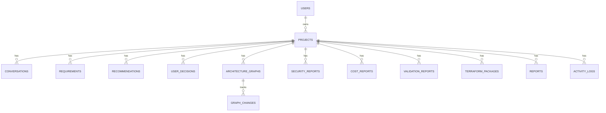
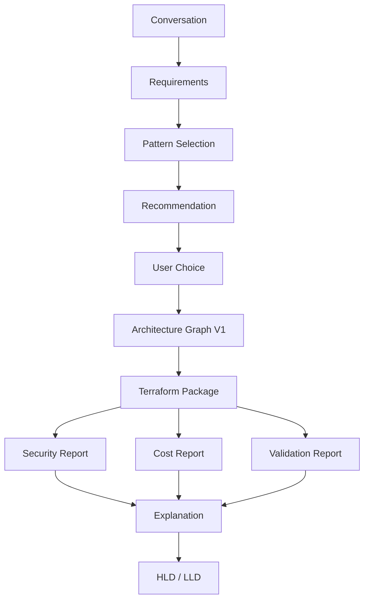

# DOPA Project Data Model

## 🎯 Core Principle
Everything belongs to a **Project**.

```text
User → Project → (Conversations, Requirements, Graphs, Reports, Terraform, Logs)
```

---

## 🗺️ Conceptual ER Diagram


---

## 🗄️ Database Tables (PostgreSQL)

### 1. `users`
| Field | Type | Description |
|---|---|---|
| `id` | UUID | Primary Key |
| `email` | VARCHAR | User email |
| `name` | VARCHAR | User full name |
| `plan` | VARCHAR | e.g., 'free', 'pro' |
| `created_at` | TIMESTAMP | Creation date |

### 2. `projects`
*(Most important table)*
| Field | Type | Description |
|---|---|---|
| `id` | UUID | Primary Key |
| `user_id` | UUID | Foreign Key -> `users.id` |
| `name` | VARCHAR | Project name (e.g., "Ecommerce Platform") |
| `description` | TEXT | Optional description |
| `cloud_provider` | VARCHAR | Target cloud (e.g., "aws") |
| `status` | VARCHAR | Current project state |
| `current_graph_version` | INT | Tracks latest architecture version |
| `created_at` | TIMESTAMP | Creation date |

### 3. `conversations`
Stores discovery sessions for the Conversation Engine.
| Field | Type | Description |
|---|---|---|
| `id` | UUID | Primary Key |
| `project_id` | UUID | Foreign Key -> `projects.id` |
| `role` | VARCHAR | 'user' or 'assistant' |
| `message` | TEXT | Chat payload |
| `created_at` | TIMESTAMP | Message timestamp |

### 4. `requirements`
Stores the normalized JSON output from the Requirement Engine.
| Field | Type | Description |
|---|---|---|
| `id` | UUID | Primary Key |
| `project_id` | UUID | Foreign Key -> `projects.id` |
| `version` | INT | Requirement iteration |
| `requirements_json` | JSONB | Structured requirements payload |
| `created_at` | TIMESTAMP | Creation date |

### 5. `recommendations`
Stores generated A/B/C options.
| Field | Type | Description |
|---|---|---|
| `id` | UUID | Primary Key |
| `project_id` | UUID | Foreign Key -> `projects.id` |
| `option_type` | VARCHAR | 'cheapest', 'balanced', 'enterprise' |
| `score` | FLOAT | Confidence or fit score |
| `architecture_json` | JSONB | Proposed high-level pattern |

### 6. `user_decisions`
Stores what option the user selected to move forward with.
| Field | Type | Description |
|---|---|---|
| `id` | UUID | Primary Key |
| `project_id` | UUID | Foreign Key -> `projects.id` |
| `recommendation_id` | UUID | Foreign Key -> `recommendations.id` |
| `selected` | BOOLEAN | True if selected |
| `created_at` | TIMESTAMP | Selection timestamp |

### 7. `architecture_graphs`
*(The most valuable table in DOPA)*
| Field | Type | Description |
|---|---|---|
| `id` | UUID | Primary Key |
| `project_id` | UUID | Foreign Key -> `projects.id` |
| `version` | INT | Graph version |
| `graph_json` | JSONB | The complete node/edge structure |
| `pattern_id` | VARCHAR | Base pattern used |
| `created_at` | TIMESTAMP | Generation date |

> **Why Versioning Matters:** If a user adds Redis on Day 10, it creates Graph V2. If they add Kafka on Day 20, it creates Graph V3. Nothing is overwritten. Everything is versioned.

### 8. `graph_changes` (Future-proofing)
| Field | Type | Description |
|---|---|---|
| `id` | UUID | Primary Key |
| `graph_id` | UUID | Foreign Key -> `architecture_graphs.id` |
| `change_type` | VARCHAR | e.g., 'ADD_NODE' |
| `description` | TEXT | e.g., 'Redis Cluster Added' |
| `created_at` | TIMESTAMP | Change timestamp |

### 9. `security_reports`
| Field | Type | Description |
|---|---|---|
| `id` | UUID | Primary Key |
| `project_id` | UUID | Foreign Key -> `projects.id` |
| `graph_version` | INT | Graph version analyzed |
| `report_json` | JSONB | Detailed findings (Checkov/Trivy) |
| `risk_score` | FLOAT | Calculated risk level |

### 10. `cost_reports`
*(Aligned with Sprint 1 Scope: Uses static internal pricing models)*
| Field | Type | Description |
|---|---|---|
| `id` | UUID | Primary Key |
| `project_id` | UUID | Foreign Key -> `projects.id` |
| `graph_version` | INT | Graph version analyzed |
| `estimated_monthly_cost` | DECIMAL | Total monthly estimate |
| `report_json` | JSONB | Cost breakdown per resource |

### 11. `validation_reports`
| Field | Type | Description |
|---|---|---|
| `id` | UUID | Primary Key |
| `project_id` | UUID | Foreign Key -> `projects.id` |
| `graph_version` | INT | Graph version validated |
| `status` | VARCHAR | 'pass', 'fail' |
| `report_json` | JSONB | Terraform validation details |

### 12. `terraform_packages`
| Field | Type | Description |
|---|---|---|
| `id` | UUID | Primary Key |
| `project_id` | UUID | Foreign Key -> `projects.id` |
| `graph_version` | INT | Corresponding graph version |
| `package_path` | TEXT | S3 or local path (e.g., `terraform/v3.zip`) |
| `created_at` | TIMESTAMP | Generation date |

### 13. `reports` (Generated Documents)
| Field | Type | Description |
|---|---|---|
| `id` | UUID | Primary Key |
| `project_id` | UUID | Foreign Key -> `projects.id` |
| `report_type` | VARCHAR | 'HLD', 'LLD', 'Security', 'Cost', 'Validation', 'Explanation' |
| `graph_version` | INT | Graph version documented |
| `file_path` | TEXT | Path to generated PDF/MD |

### 14. `activity_logs` (Audit Trail)
| Field | Type | Description |
|---|---|---|
| `id` | UUID | Primary Key |
| `project_id` | UUID | Foreign Key -> `projects.id` |
| `event_type` | VARCHAR | e.g., 'GRAPH_GENERATED', 'PROJECT_CREATED' |
| `payload` | JSONB | Event metadata |
| `created_at` | TIMESTAMP | Event timestamp |

---

## ⚡ Sprint 1 Optimization
To simplify the first release and align with our previous scoping decisions, we will **skip** the following tables in Sprint 1:
* ❌ `graph_changes` (Graph versioning will just create new records in `architecture_graphs` for now)
* ❌ `activity_logs` (Deferred to V2 for full auditing)
* ❌ `user_decisions` (Selection state will be tracked directly inside the `projects` table or simply implied by the final generated `architecture_graphs` record)

**Final Sprint 1 Tables:**
✅ `users`, `projects`, `conversations`, `requirements`, `architecture_graphs`, `security_reports`, `cost_reports`, `validation_reports`, `terraform_packages`, `reports`.

---

## 🔄 Final Data Lifecycle

