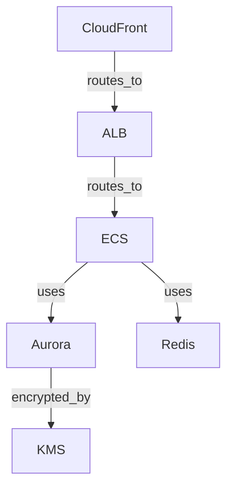
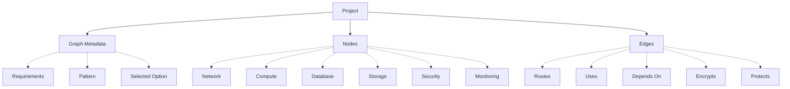

# DOPA Architecture Graph Schema v0.1

## 🌟 Core Principle
Everything becomes a graph.

```text
Requirements  →  Architecture Graph  →  Everything Else
```

The graph must be:
* **Provider Agnostic:** Usable for AWS, Azure, GCP, etc.
* **Extensible:** Easy to add new node types and relationships.
* **Serializable:** Easy to store in JSON.
* **Versionable:** Easy to track changes over time.
* **Human Readable:** Easy for engineers to understand.
* **Machine Readable:** Easy for deterministic engines to parse.

---

## 🏗️ Graph Structure

### 1. Root Structure
```json
{
 "graph_id": "graph-123",
 "project_id": "project-123",
 "version": "1.0",
 "metadata": {
   "created_at": "2026-06-05",
   "cloud": "aws",
   "region": "ap-south-1",
   "selected_option": "balanced",
   "pattern": "ecommerce"
 },
 "nodes": [],
 "edges": []
}
```

### 2. Node Schema
Every cloud component becomes a node.
```json
{
 "id": "ecs-main",
 "type": "compute",
 "provider": "aws",
 "service": "ecs",
 "name": "main-cluster",
 "tier": "application",
 "properties": {}
}
```

#### Node Types (Sprint 1):
`network`, `subnet`, `compute`, `database`, `cache`, `storage`, `load_balancer`, `cdn`, `security`, `iam`, `queue`, `dns`, `monitoring`.

#### Example Nodes:
**VPC**
```json
{
 "id": "vpc-main",
 "type": "network",
 "service": "vpc",
 "properties": {
   "cidr": "10.0.0.0/16"
 }
}
```

**ECS**
```json
{
 "id": "ecs-app",
 "type": "compute",
 "service": "ecs",
 "properties": {
   "cpu": "1024",
   "memory": "2048"
 }
}
```

**RDS**
```json
{
 "id": "rds-main",
 "type": "database",
 "service": "aurora-postgresql",
 "properties": {
   "multi_az": true
 }
}
```

### 3. Edge Schema
Edges describe relationships between nodes.
```json
{
 "id": "edge-1",
 "source": "alb-main",
 "target": "ecs-app",
 "relationship": "routes_to",
 "properties": {}
}
```

#### Supported Relationships:
* **Network Relationships:** `contains`, `attached_to`, `connected_to`
  * *Example:* VPC → `contains` → Subnet
* **Traffic Relationships:** `routes_to`, `sends_to`, `receives_from`
  * *Example:* ALB → `routes_to` → ECS
* **Security Relationships:** `protected_by`, `encrypted_by`, `assumes_role`
  * *Example:* RDS → `encrypted_by` → KMS
* **Dependency Relationships:** `depends_on`, `uses`
  * *Example:* ECS → `uses` → RDS

---

## 🔍 Engine Views

### Complete Architecture Example


```json
{
 "nodes": [
   { "id": "cloudfront", "type": "cdn" },
   { "id": "alb", "type": "load_balancer" },
   { "id": "ecs", "type": "compute" },
   { "id": "aurora", "type": "database" }
 ],
 "edges": [
   { "source": "cloudfront", "target": "alb", "relationship": "routes_to" },
   { "source": "alb", "target": "ecs", "relationship": "routes_to" },
   { "source": "ecs", "target": "aurora", "relationship": "uses" }
 ]
}
```

### Security View
The Security Engine parses the graph against defined rules.
* **Example Rule:**
  ```json
  {
   "rule_id": "db_public",
   "node_type": "database",
   "condition": { "public_access": true },
   "severity": "critical"
  }
  ```
* **Execution Flow:** `Graph → Find Database Nodes → Apply Rules → Output Findings`

### Cost View
The Cost Engine estimates infrastructure costs by traversing the graph.
*(Note: As established for Sprint 1, Cost Analysis uses static pricing models to bypass live AWS API latency, executed at final generation rather than live per click).*
* **Execution Flow:** `ECS Node (Pricing Rule) + Aurora Node (Pricing Rule) + ALB Node (Pricing Rule) = Output Monthly Cost.`

### Terraform View
Terraform Generator reads the graph to template IaC.
* **Execution Flow:** `{"type": "compute", "service": "ecs"}` → `templates/aws/ecs` → `modules/compute`

---

## 🚀 Future Vision: Architecture Evolution Support
Graph-based design naturally supports versioning.
* **Current:** Graph V1
* **User Action:** Add Redis
* **Produces:** Graph V2
```json
{
 "change_request": "add_redis",
 "base_graph": "graph-v1",
 "new_graph": "graph-v2"
}
```

---

## 📂 Final Graph Hierarchy



---

## ⚖️ Architectural Decision Record (ADR)
For Sprint 1:
* ✅ **Store graph as JSON in PostgreSQL.** (Simple, robust, perfectly adequate for the scale).
* ❌ **Do not use Neo4j.** (Overkill for Phase 1).
* ❌ **Do not use graph databases.** (Same as above, stick to simple RDBMS JSONB).
* ❌ **Do not use Graph Neural Networks.** (The graph is a canonical infrastructure model, not a data science project).
