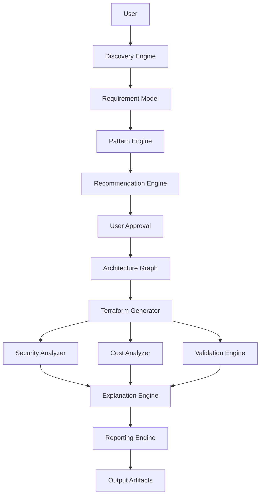
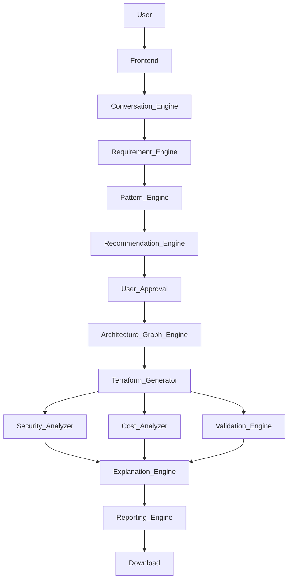
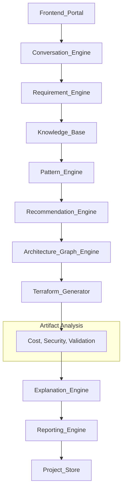

# DOPA High-Level Design (HLD)

## 1. System Overview
DOPA is an AI-powered Infrastructure Architecture Platform that converts business requirements into validated cloud architectures, reports, and Terraform artifacts.

### Primary Workflow


## 2. System Components

### Component 1: Frontend Portal
* **Purpose:** User interaction layer.
* **Responsibilities:**
  * Authentication
  * Project Creation
  * Requirement Collection
  * **Interactive Architecture Canvas** (Allows users to visually tweak nodes and trigger real-time Security/Architecture validations, deferring Cost Analysis to the final step).
  * Report Viewing
  * Terraform Download
* **Technology (Suggested):** Next.js, TypeScript, Tailwind, React Flow.

### Component 2: Conversation Engine
* **Purpose:** Acts as the Solution Architect.
* **Responsibilities:** Requirement Discovery, Question Generation, Context Retention, Requirement Validation.
* **Input Example:** `{"user_message": "Deploy ecommerce application"}`
* **Output Example:** `{"next_question": "Expected traffic?"}`

### Component 3: Requirement Engine
* **Purpose:** Convert conversations into structured requirements.
* **Responsibilities:** Requirement Extraction, Schema Validation, Normalization.
* **Output Example:**
  ```json
  {
   "cloud": "aws",
   "region": "ap-south-1",
   "traffic": "10000/day",
   "database": "postgresql"
  }
  ```

### Component 4: Knowledge Base
* **Purpose:** Central decision repository.
* **Cloud-Agnostic Design:** Built to completely abstract cloud-specific configurations (JSON/YAML), ensuring future support for Azure/GCP is seamlessly added via new patterns, without core engine rewrites.
* **Contains:** Architecture Patterns, Service Capabilities, Tradeoff Rules, Security Rules, Cost Rules, Validation Rules, Question Flows, Terraform Module Catalog.
* **Storage:** JSON / YAML.
* **Sprint 1 Status:** No database required (file-based).

### Component 5: Pattern Engine
* **Purpose:** Convert requirements into architecture patterns.
* **Input Example:** `{"application_type": "social_media", "users": 5000000}`
* **Output Example:** `{"pattern": "global_realtime_platform"}`
* **Supported Patterns:** Startup, SaaS, Enterprise, Social Media, Streaming, Chat, AI, Batch, Event Driven, Multi Region.

### Component 6: Recommendation Engine
* **Purpose:** Generate architecture options. User approval is strictly required before proceeding.
* **Produces:**
  * Option A → Cheapest
  * Option B → Balanced
  * Option C → Enterprise
* **Output Example:** `{"recommended": "B"}`

### Component 7: Architecture Graph Engine
* **Purpose:** Convert architecture selection into a graph model. This graph is the **Source of Truth** consumed by everything downstream.
* **Live Sandbox Integration:** The graph directly powers the Interactive Architecture Canvas on the frontend, allowing dynamic user manipulation of the architecture before Terraform generation (triggers real-time Security/Validation checks).
* **Graph Structure:** Nodes, Edges, Metadata.
* **Example Diagram:**
  ```mermaid
  graph TD
      CloudFront --> ALB
      ALB --> ECS
      ECS --> Aurora
  ```

### Component 8: Security Analyzer
* **Purpose:** Detect security issues before deployment.
* **Checks:** Public Databases, Public Buckets, Weak IAM, Missing Encryption, Open Security Groups.
* **Tools:** Checkov, Trivy.
* **Output Example:**
  ```json
  {
   "risk": "medium",
   "findings": []
  }
  ```

### Component 9: Cost Analyzer
* **Purpose:** Estimate infrastructure cost and provide optimization suggestions (V1 relies on static pricing models and runs once during report generation, avoiding live AWS API calls per click).
* **Sources:** Static Cost Rules, Internal Estimation Models.
* **Output Example:** `{"monthly_cost": 245.20}`

### Component 10: Validation Engine
* **Purpose:** Validate architecture and Terraform.
* **Checks:** `terraform fmt`, `terraform validate`.
* **Architecture Checks:** Single Point of Failure (SPOF), Backup Strategy, Monitoring, DR Readiness.
* **Output Example:** `{"status": "valid"}`

### Component 11: Terraform Generator
* **Purpose:** Generate Infrastructure as Code.
* **Generation Method:** Architecture Graph + Knowledge Base + Templates (This is **NOT** LLM-generated Terraform).
* **Output Structure:** `provider.tf`, `variables.tf`, `outputs.tf`, `modules/`.

### Component 12: Explanation Engine
* **Purpose:** Provide transparency and build user trust by explaining *Why* an architecture was chosen.
* **Input:** Selected Option (e.g., Option A).
* **Output Example:**
  ```json
  {
   "chosen_because": [
     "Team size small",
     "Lower operational overhead",
     "Cost target under $300/month",
     "Kubernetes not required"
   ]
  }
  ```

### Component 13: Reporting Engine
* **Purpose:** Generate documents.
* **Outputs:** HLD, LLD, Security Report, Cost Report, Validation Report, Explanation Narrative.
* **Formats:** PDF, Markdown, HTML.

### Component 14: Project Store
* **Purpose:** Store projects for persistence.
* **Stores:** Requirements, Graphs, Reports, Terraform Packages, User Decisions.
* **Suggested DB:** PostgreSQL.

---

## 3. High-Level Data Flow


---

## 4. External Integrations
| Integration | Used By |
|---|---|
| **Checkov** | Security Analyzer |
| **Trivy** | Validation Engine |
| **Terraform CLI** | Validation Engine, Terraform Generator |

---

## 5. Non-Functional Requirements
* **Scalability:** Handle 1000+ Projects, Concurrent Analysis.
* **Security:** JWT Authentication, Encrypted Storage, Role Based Access (RBAC).
* **Reliability:** Project Recovery, Versioned Artifacts.
* **Performance Targets:**
  * Requirement Analysis < 10 sec
  * Architecture Generation < 30 sec
  * Terraform Generation < 60 sec

---

## 6. Final HLD Architecture

*This HLD is now stable enough to become the architectural blueprint of DOPA.*
