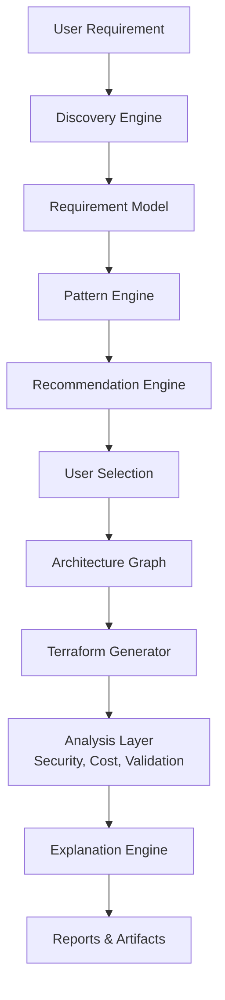

# DOPA v0.1: DevOps Planning & Architecture

## 🎯 Mission
DOPA is an AI-powered Infrastructure Architecture and DevOps Decision Platform. Its purpose is to transform business requirements into secure, validated, cost-aware infrastructure architectures and deployment-ready Terraform artifacts.

* **Role:** DOPA acts as an Infrastructure Architect rather than a generic AI assistant.
* **Control:** The user remains in control of all final decisions.
* **Mantra:** DOPA recommends. User approves.

## ⚠️ Core Problem
Modern cloud infrastructure design requires expertise in Cloud Architecture, Security, Cost Optimization, Infrastructure as Code, Terraform, AWS Services, Reliability Engineering, and Scalability Planning.

Engineers often spend days designing architectures before writing a single line of infrastructure code. **DOPA compresses this process into a guided workflow.**

## 🧠 Core Philosophy
DOPA follows five principles:
1. **Architecture First**
2. **Human-in-the-Loop**
3. **Explain Every Decision**
4. **Graph-Centric Design**
5. **Deterministic Infrastructure Generation**

* **AI** is used for reasoning and explanation.
* **Deterministic engines** are used for Architecture selection, Security validation, Cost estimation, Terraform generation, and Infrastructure validation.

---

## 🔄 DOPA Core Workflow



---

## 🛠️ Phases Breakdown

### Phase 1: Discovery Engine
* **Purpose:** Collect infrastructure requirements through a structured conversation. The engine behaves like a Solution Architect.
* **Example Flow:**
  * User: Build an ecommerce platform.
  * DOPA: Expected traffic? Cloud provider? Region? Budget? Availability? DB requirements? Compliance?
* **Output:** Requirement Model (Structured Data)
  ```json
  {
    "application_type": "ecommerce",
    "cloud": "aws",
    "region": "ap-south-1",
    "traffic": 10000,
    "availability": "high"
  }
  ```

### Phase 2: Pattern Engine
* **Purpose:** Translate requirements into known infrastructure patterns before selecting specific cloud services.
* **Supported Patterns:** Small Startup, Medium SaaS, Enterprise SaaS, Social Media / Global Real-Time, Real-Time Chat, Streaming, AI Workload, Event-Driven, Batch Processing, Multi-Region.
* **Output:** Pattern Selection
  ```mermaid
  graph LR
      A[Social Media] --> B[5M Users]
      B --> C[Low Latency]
      C --> D[Global Real-Time Platform]
  ```

### Phase 3: Recommendation Engine
* **Purpose:** Generate multiple architecture recommendations. DOPA never forces a single architecture.
* **Options:**
  * **Option A (Cheapest):** Focuses on Cost Minimization (e.g., ECS + RDS Single-AZ).
  * **Option B (Balanced):** Focuses on Performance vs. Cost (e.g., ECS + Aurora Multi-AZ).
  * **Option C (Enterprise):** Focuses on Maximum Reliability (e.g., EKS + Aurora Global).
* **Control:** User chooses. DOPA only continues after approval.

### Phase 4: Architecture Graph
The Architecture Graph becomes the central source of truth for downstream processes (Security, Cost, Terraform, Reports, Validation).

* **Interactive Architecture Canvas:** In the web application, this graph functions as a live sandbox. If a user clicks on a node (e.g., an EC2 instance) to change its configuration, the Security Analyzer and Validation Engine re-run in real-time, providing immediate feedback (Cost Analysis uses a static estimation model in V1, run at the final step).
* **Nodes:** Compute, Database, Networking, Storage, IAM, Security.
* **Edges:** Access, Communication, Trust Relationships, Encryption Relationships.

* **Example Graph:**
  ```mermaid
  graph LR
      CF[CloudFront] --> ALB[ALB]
      ALB --> ECS[ECS]
      ECS --> Aurora[(Aurora)]
      ECS --> Redis[(Redis)]
  ```

### Phase 5: Terraform Generator
* **Purpose:** Generate deployment-ready infrastructure.
* **Strategy:** Knowledge Base + Architecture Graph + Terraform Templates. (NOT raw AI generation).
* **Output Structure:** `provider.tf`, `variables.tf`, `outputs.tf`, and modular components (network, database, compute, security).
* **Design Principles:** Modular, Reusable, Secure by Default, Environment Aware.

### Phase 6: Security Analyzer
* **Purpose:** Evaluate architecture and generated Terraform before deployment.
* **Checks:** Public Databases, Public Buckets, Open Ports, Weak IAM Policies, Missing Encryption, Secret Exposure, Security Group Violations.
* **Tools Used:** Checkov, Trivy.
* **Outputs:** Security Report, Risk Score, Recommendations.

### Phase 7: Cost Analyzer
* **Purpose:** Estimate monthly infrastructure cost.
* **Inputs/Tools:** Static Cost Rules (cost-rules.json), Static Pricing Models, Service Metadata.
* **Calculates:** Compute, Storage, Database, Data Transfer, and Network Costs.
* **Outputs:** Estimated Monthly Cost, Cost Breakdown, Optimization Suggestions.

### Phase 8: Validation Engine
* **Purpose:** Validate architecture and generated Terraform.
* **Checks:**
  * Terraform: `terraform fmt`, `terraform validate`.
  * Architecture: Single Points of Failure, Missing Backups/Monitoring/DR Strategy.
  * Security: Compliance & Policy Violations.
* **Output:** Validation Report.

### Phase 9: Explanation Engine
* **Purpose:** Answer "Why was this architecture chosen?" and generate trust-building rationale.
* **Inputs:** Architecture Graph, Requirement Model, Tradeoff Rules, Security/Cost/Validation Reports.
* **Outputs:** Decision Rationale, Tradeoff Explanations, Alternative Comparisons.
* **Design:** Uses LLM reasoning over structured data to produce human-readable justifications for every major architectural decision.

### Phase 10: Reporting Engine
* **Produces HLD (High Level Design):** Business Context, Architecture Overview, Diagrams, Service Selection, Cost/Security Summaries.
* **Produces LLD (Low Level Design):** Networking, Compute, Database, IAM, Security Rules, Terraform Mapping.

---

## 📚 Knowledge Base
DOPA's intelligence is stored in structured files. The knowledge base acts as the primary decision engine, while LLMs provide reasoning and explanations.

* **Cloud-Agnostic Design:** Schemas (`architecture-patterns.json`, `service-capabilities.json`, etc.) are built to be completely cloud-agnostic. This ensures that while AWS may be the primary target initially, supporting Azure or GCP later is simply a matter of adding new JSON definitions rather than refactoring the core engine.

```text
knowledge/
├── architecture-patterns.json
├── service-capabilities.json
├── tradeoff-rules.json
├── security-rules.json
├── validation-rules.json
├── cost-rules.json
├── recommendation-rules.json
├── question-flows.json
└── terraform-module-catalog.json
```

---

## 🚀 Sprint 1 Deliverables (Web Application)

* [x] Discovery Engine
* [x] Requirement Model
* [x] Pattern Engine
* [x] Recommendation Engine
* [x] Architecture Graph
* [x] Terraform Generator
* [x] Security Analyzer
* [x] Cost Analyzer
* [x] Validation Engine
* [x] Explanation Engine
* [x] HLD & LLD Generator

**Final Outputs per Run:** Architecture Recommendation, Architecture Diagram, Terraform Package, Security Report, Cost Report, Validation Report, Decision Rationale, HLD, LLD.
