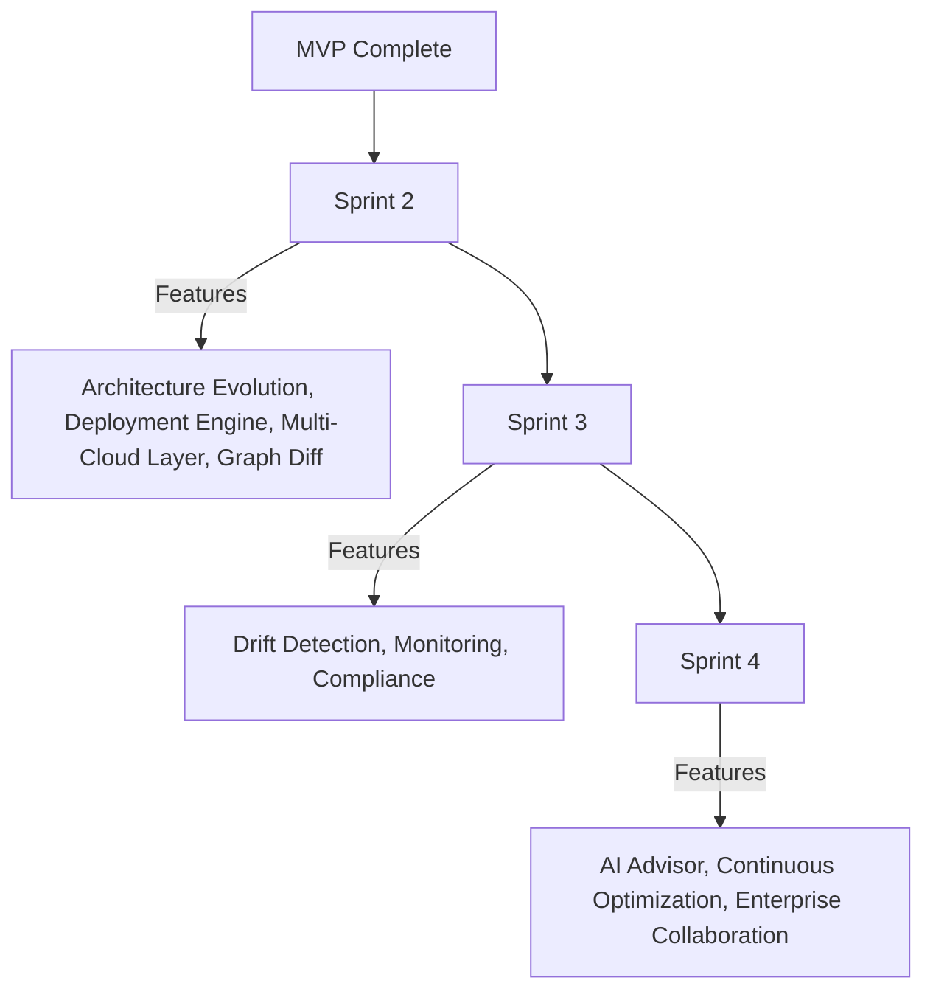

# DOPA Sprint 1 Implementation Blueprint

## 🎯 Goal
Build a production-quality MVP that can collect requirements, generate architecture options, build architecture graphs, analyze security, estimate cost, generate Terraform, generate HLD, generate LLD, and package artifacts within **30 - 45 Days**.

## ✅ Success Criteria
A user should be able to:
1. Create a Project
2. Answer Discovery Questions
3. Select an Architecture
4. Review Cost
5. Review Security
6. Download Terraform
7. Download HLD
8. Download LLD
*(All without any manual engineering work).*

---

## 🛠️ Technology Stack

### Frontend
* **Recommended:** Next.js 15, TypeScript, TailwindCSS, Shadcn UI, React Flow, TanStack Query.
* **Why:** Fast Development, Excellent UI, Built-in Graph Visualization capabilities.

### Backend
* **Recommended:** FastAPI, Python 3.12, Pydantic, SQLAlchemy, Alembic.
* **Why:** Strong AI Integration ecosystem, Native JSON Handling, Terraform Automation capability.

### Infrastructure
* **Database:** PostgreSQL (Stores Projects, Requirements, Graphs, Reports, Artifacts).
* **Cache:** None (Skipped for Sprint 1, add Redis later).
* **Object Storage:** Local Storage for Sprint 1 (Amazon S3 in Production).

### AI Layer
* **Recommended:** OpenAI / Anthropic / Gemini.
* **Architecture:** Through an **AI Gateway Layer**. Never call providers directly from business logic.

---

## 📁 Repository Structure
```text
dopa/
├── apps/
│   ├── frontend/
│   └── backend/
├── services/
│   ├── conversation-engine/
│   ├── requirement-engine/
│   ├── pattern-engine/
│   ├── recommendation-engine/
│   ├── graph-engine/
│   ├── security-engine/
│   ├── cost-engine/
│   ├── validation-engine/
│   ├── terraform-engine/
│   ├── report-engine/
│   └── explanation-engine/
├── knowledge/
├── templates/
├── schemas/
├── generated/
├── evaluation/
│   ├── requirements/
│   ├── patterns/
│   ├── graphs/
│   └── security/
└── docs/
```

### Backend Internal Structure
```text
backend/
├── api/
├── services/
├── repositories/
├── models/
├── schemas/
├── utils/
├── knowledge/
└── templates/
```

---

## 📅 Sprint Phases

### Phase 1 (Week 1): Foundation Setup
* **Backend:** FastAPI Setup, PostgreSQL Setup, Alembic, Authentication.
* **Frontend:** Next.js Setup, Login Page, Dashboard, Project Creation.
* **Database:** Implement `users`, `projects`, `requirements`, `architecture_graphs`.
* 🏆 **Milestone 1:** User can create projects.

### Phase 2 (Week 2): Discovery Engine
* **Build:** Conversation Engine, Requirement Engine, Question Flow Loader.
* **Implement:** `question-flows.json`.
* 🏆 **Milestone 2:** Requirements can be collected automatically.

### Phase 3 (Week 3): Pattern Engine & Recommendations
* **Pattern Engine:** Build Pattern Matching, Scoring, and Selection using `architecture-patterns.json`.
* **Recommendation Engine:** Generate Option A, Option B, and Option C using `recommendation-rules.json`.
* 🏆 **Milestone 3:** Architecture options generated.

### Phase 4 (Week 4): Architecture Graph Engine
* **Build:** Node Builder, Edge Builder, Graph Validator, Graph Serializer.
* **Implement:** Architecture Graph Schema.
* **Store:** `architecture_graphs`.
* 🏆 **Milestone 4:** Graph generation works.

### Phase 5 (Week 5): Analysis Engines
* **Security:** Rule Loader, Security Scanner (`security-rules.json`).
* **Cost:** Pricing Engine, Cost Calculator (`cost-rules.json` - Static estimation for V1).
* **Validation:** Architecture Validation, Terraform Validation (`validation-rules.json`).
* 🏆 **Milestone 5:** Security + Cost + Validation reports available.

### Phase 6 (Week 6): Terraform & Reporting
* **Terraform Engine:** Template Resolver, Module Generator, Artifact Builder (`terraform-module-catalog.json`). Templates for `vpc`, `ecs`, `rds`, `alb`, `s3`. Generates `provider.tf`, `variables.tf`, `outputs.tf`.
* **Explanation Engine:** Translates deterministic graph and selection data into natural language rationale (Why Option A was chosen).
* **Report Engine:** Generate `HLD`, `LLD`, `Security`, `Cost`, `Validation`, and `Explanation` documents.
* 🏆 **Milestone 6:** Downloadable artifacts available.

---

## 🔌 API Contracts
* **Project:** `POST /projects`, `GET /projects/{id}`
* **Conversation:** `POST /conversation/message`
* **Requirements:** `GET /requirements/{projectId}`
* **Pattern:** `POST /patterns/generate`
* **Recommendations:** `POST /recommendations/generate`
* **Graph:** `POST /graph/generate`
* **Security:** `POST /security/analyze`
* **Cost:** `POST /cost/analyze`
* **Terraform:** `POST /terraform/generate`
* **Reports:** `POST /reports/generate`

---

## 🧠 AI Strategy (Critical)

**✅ USE AI FOR:**
* Requirement Extraction
* Question Generation
* Pattern Explanation
* Tradeoff Explanation
* Report Narratives

**❌ DO NOT USE AI FOR:**
* Terraform Generation
* Cost Calculation
* Graph Creation
* Security Validation
* Rule Execution
*(These must be deterministic).*

---

## 🔒 Sprint 1 Scope Lock
* **Allowed:** AWS, Terraform, Architecture Graph, Cost, Security, Validation, Reports.
* **Not Allowed:** Azure, GCP, Deployment, Drift Detection, Monitoring, Compliance, Auto Remediation, Agent Swarms.

---

## 🎯 Sprint 1 Final Deliverable
* **User Enters:** "Build ecommerce application."
* **DOPA Returns:** Architecture Diagram, Options A/B/C, Cost Report, Security Report, Validation Report, Terraform Package, HLD, LLD.

---

## 🛣️ Post-Sprint 1 Roadmap


---

## 💡 Final Recommendation
**Before writing any code, create these files first:**
```text
knowledge/
├── architecture-patterns.json
├── recommendation-rules.json
├── service-capabilities.json
├── security-rules.json
├── validation-rules.json
├── cost-rules.json
├── tradeoff-rules.json
├── question-flows.json
└── terraform-module-catalog.json
```

---

## Related Pipeline Note
- See [Docs/core_engines_pipeline_v1.md](D:/Mine/DOPA/Docs/core_engines_pipeline_v1.md) for the pure-Python core engine implementation plan and graph template contract.
