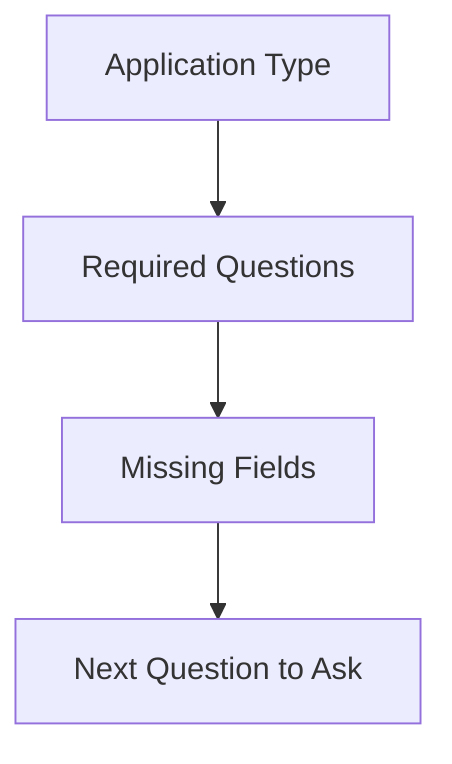
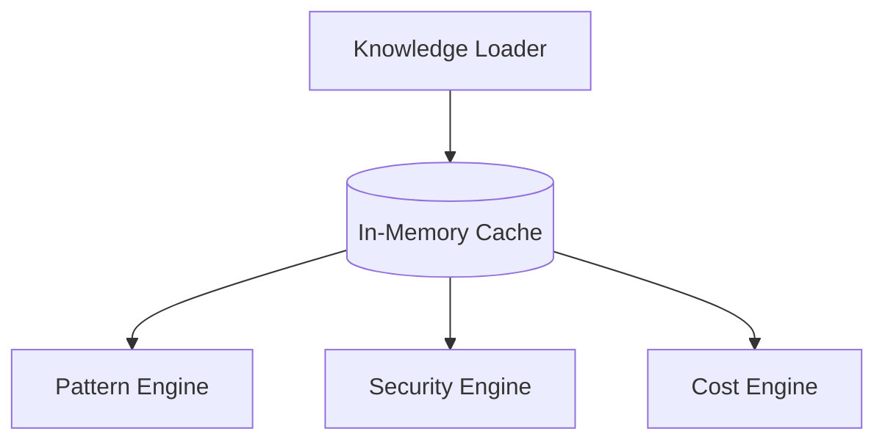
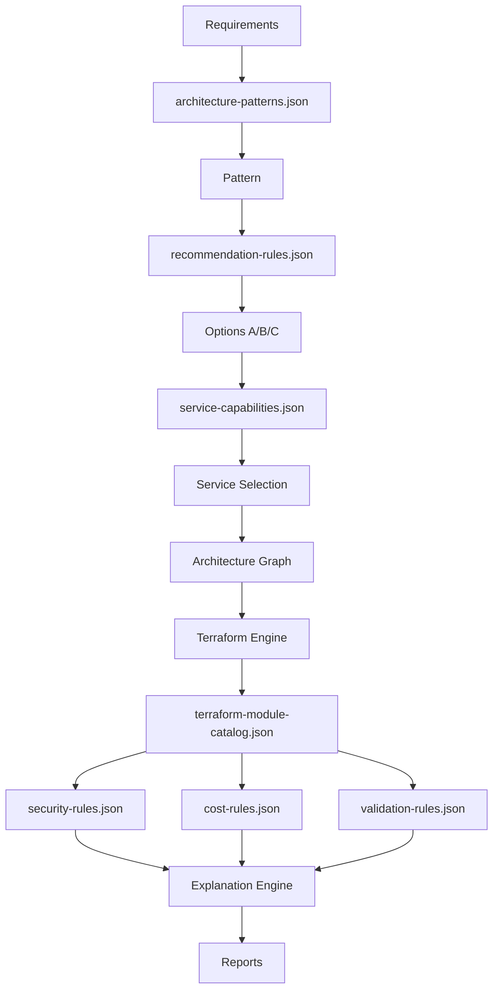

# DOPA Knowledge Base Schema v0.1

## 🧠 Core Design Principle
Knowledge must be:
* **Structured**
* **Versioned**
* **Explainable**
* **Searchable**
* **Provider Agnostic**
* **Human Editable**

**No hardcoded rules inside services.** Everything possible should come from knowledge files.

---

## 📁 Knowledge Directory
```text
knowledge/
├── architecture-patterns.json
├── service-capabilities.json
├── tradeoff-rules.json
├── recommendation-rules.json
├── security-rules.json
├── validation-rules.json
├── cost-rules.json
├── question-flows.json
├── terraform-module-catalog.json
└── provider-mappings.json
```

---

## 📄 File Schemas

### 1. `architecture-patterns.json`
*(Most important file)*
* **Purpose:** Maps Requirements → Architecture Pattern.

**Schema & Example:**
```json
{
 "pattern_id": "global_realtime_platform",
 "name": "Social Media Platform",
 "description": "High throughput, globally distributed real-time platform",
 "conditions": {
   "application_type": "social_media",
   "users": ">1000000"
 },
 "logical_components": [
   "cdn",
   "compute",
   "database",
   "cache",
   "search"
 ],
 "default_services": [
   "cloudfront",
   "eks",
   "aurora",
   "redis",
   "opensearch"
 ],
 "tags": ["global", "realtime", "high-scale"]
}
```

### 2. `service-capabilities.json`
* **Purpose:** Service Selection & Evaluation.

**Schema & Example:**
```json
{
 "service": "ecs",
 "provider": "aws",
 "category": "compute",
 "best_for": [
   "webapps",
   "microservices"
 ],
 "cost_level": "medium",
 "complexity": "medium",
 "scalability": "high",
 "managed": true
}
```

### 3. `tradeoff-rules.json`
* **Purpose:** Decision Intelligence. Explains choices like ECS vs EKS, Aurora vs DynamoDB, Redis vs DAX.

**Schema & Example:**
```json
{
 "decision": "ecs_vs_eks",
 "recommended_when": [
   "small_team",
   "simple_operations"
 ],
 "avoid_when": [
   "complex_kubernetes_needs"
 ],
 "advantages": [
   "easy_management"
 ],
 "disadvantages": [
   "less_control"
 ]
}
```

### 4. `recommendation-rules.json`
* **Purpose:** Generates A/B/C Options (Cheapest, Balanced, Enterprise).

**Schema & Example:**
```json
{
 "pattern": "ecommerce",
 "option_a": {
   "database": "rds_single_az"
 },
 "option_b": {
   "database": "aurora_multi_az"
 },
 "option_c": {
   "database": "aurora_global"
 }
}
```

### 5. `security-rules.json`
* **Purpose:** Security Analysis against the Architecture Graph.

**Schema & Example:**
```json
{
 "rule_id": "db_public",
 "severity": "critical",
 "target_type": "database",
 "condition": {
   "public_access": true
 },
 "message": "Database publicly accessible",
 "recommendation": "Move database into private subnet"
}
```

### 6. `validation-rules.json`
* **Purpose:** Architecture Structural Validation.

**Schema & Example:**
```json
{
 "rule_id": "single_point_failure",
 "severity": "high",
 "condition": {
   "multi_az": false
 },
 "message": "Single point of failure detected"
}
```

### 7. `cost-rules.json`
* **Purpose:** Quick Cost Estimates (Powers the static pricing models in V1).

**Schema & Example:**
```json
{
 "service": "alb",
 "pricing_type": "monthly",
 "baseline_monthly": 25,
 "unit": "per_instance"
}
```

### 8. `question-flows.json`
* **Purpose:** Discovery Engine logic (Extremely Important).

**Schema & Example:**
```json
{
 "application_type": "ecommerce",
 "required_questions": [
   "traffic",
   "database",
   "availability",
   "region",
   "budget"
 ]
}
```

**Dynamic Flow:**


### 9. `terraform-module-catalog.json`
* **Purpose:** Maps Graph Nodes to Terraform modules.

**Schema & Example:**
```json
{
 "service": "ecs",
 "module_path": "templates/aws/ecs",
 "required_inputs": [
   "vpc_id",
   "subnet_ids"
 ]
}
```

### 10. `provider-mappings.json`
* **Purpose:** Future Multi-Cloud Support. This enables Cloud-Agnostic design.

**Schema & Example:**
```json
{
 "logical_component": "object_storage",
 "aws": "s3",
 "azure": "blob_storage",
 "gcp": "cloud_storage"
}
```

---

## 🔄 Final Knowledge Flow

### Knowledge Loading Layer
All files are loaded at startup into memory.


### End-to-End Resolution Flow


---

## ⚖️ Architectural Decision Record (ADR)
**For Sprint 1: Do NOT store knowledge in PostgreSQL initially.**

Instead, use Git-versioned JSON Files.

**Benefits:**
* Easy Updates
* Easy Review (Pull Requests)
* Easy Testing
* Easy AI Generation (LLMs excel at modifying JSON)
* Zero Database Complexity

### 11. `aws-resource-schemas.json`
* **Purpose:** Curated AWS resource schema layer for the Terraform Engine and UI exposure rules.

**How to write it:**
* Create one resource entry per AWS resource type DOPA supports.
* Group resource fields into `basic`, `advanced`, and `expert` exposure tiers.
* Keep `required_fields` separate from `recommended_defaults`.
* Put values DOPA should manage automatically into `managed_fields`.
* Treat this file as the Sprint 1 curated schema; later it can be generated from the offline provider sync cache.

**Example:**
```json
{
  "version": "1.0.0",
  "provider": "aws",
  "mode": "curated",
  "resources": [
    {
      "resource_type": "aws_ecs_service",
      "logical_component": "compute",
      "exposure": {
        "basic_fields": ["cluster", "task_definition", "desired_count"],
        "advanced_fields": ["deployment_minimum_healthy_percent"],
        "expert_fields": ["capacity_provider_strategy"],
        "managed_fields": ["service_connect_configuration"]
      },
      "required_fields": ["cluster", "task_definition"],
      "recommended_defaults": {"launch_type": "FARGATE"}
    }
  ]
}
```
---

## Related Design Note
- [Docs/aws_resource_schema_pipeline.md](D:/Mine/DOPA/Docs/aws_resource_schema_pipeline.md) contains the sync pipeline and field-mapping rules for generating knowledge/aws-resource-schemas.json.

### 12. `architecture-templates.json`
* **Purpose:** Deterministic graph blueprints for the Graph Engine.

**How to write it:**
* One template per architecture pattern.
* Include the exact services that should appear in the graph.
* Use explicit node objects and edge objects.
* Keep edge relationships named and directional.
* Use this file to make graph generation repeatable and easy to regression test.

**Example:**
```json
{
  "pattern_id": "standard_web_app",
  "services": ["cloudfront", "alb", "ecs", "rds"],
  "nodes": [
    { "id": "cloudfront", "type": "cdn", "service": "cloudfront" },
    { "id": "alb", "type": "load_balancer", "service": "alb" },
    { "id": "ecs", "type": "compute", "service": "ecs" },
    { "id": "rds", "type": "database", "service": "rds" }
  ],
  "edges": [
    { "source": "cloudfront", "target": "alb", "relationship": "routes_to" },
    { "source": "alb", "target": "ecs", "relationship": "routes_to" },
    { "source": "ecs", "target": "rds", "relationship": "uses" }
  ]
}
```
