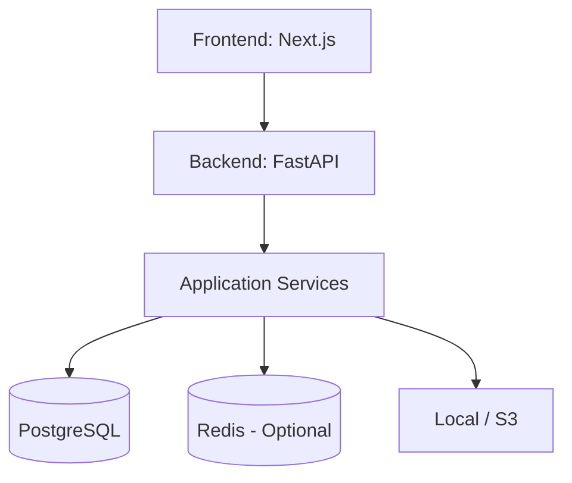
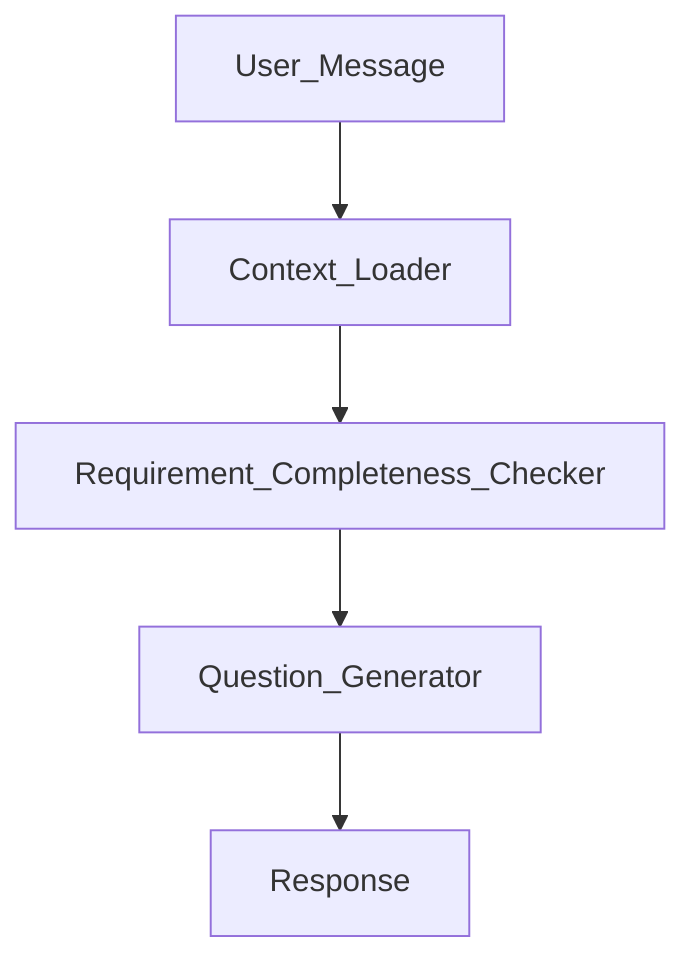
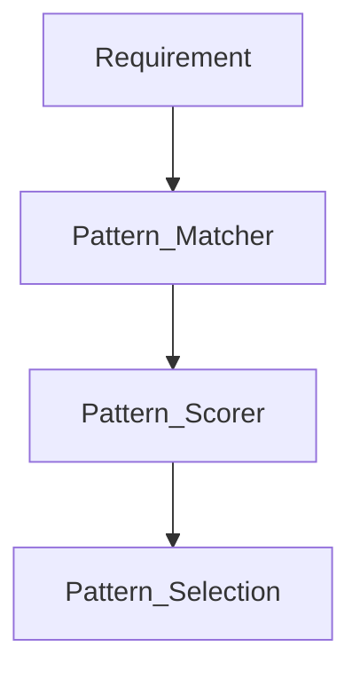
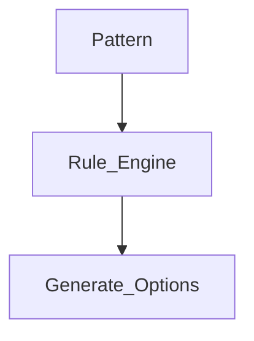
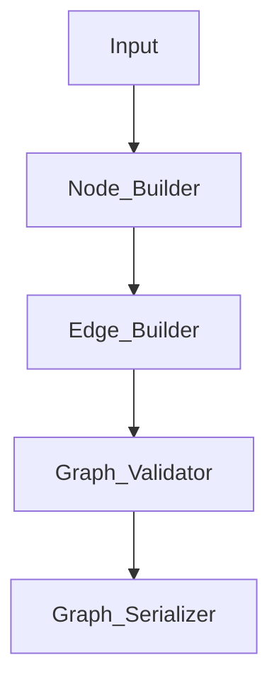
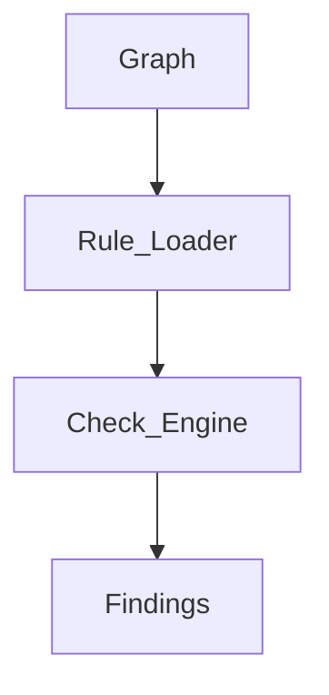
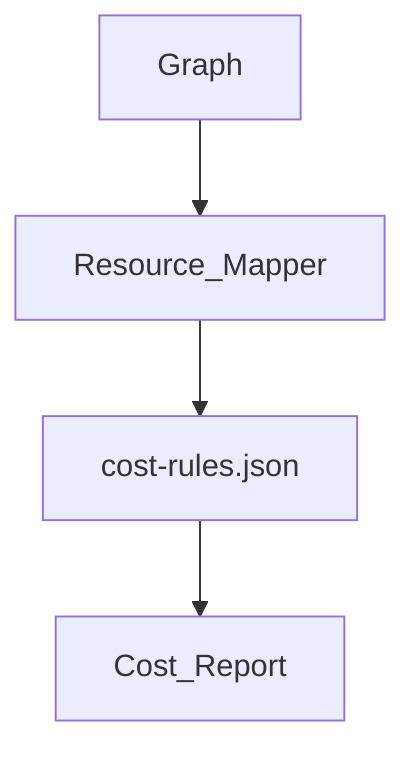
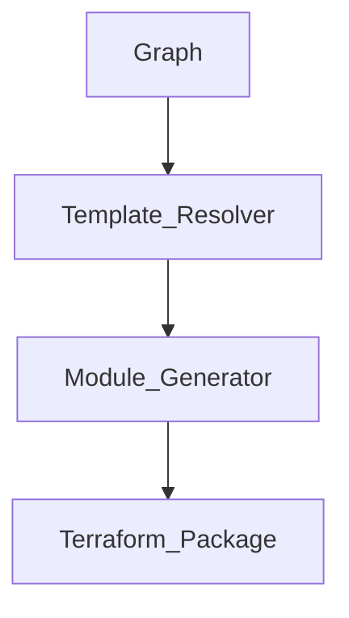
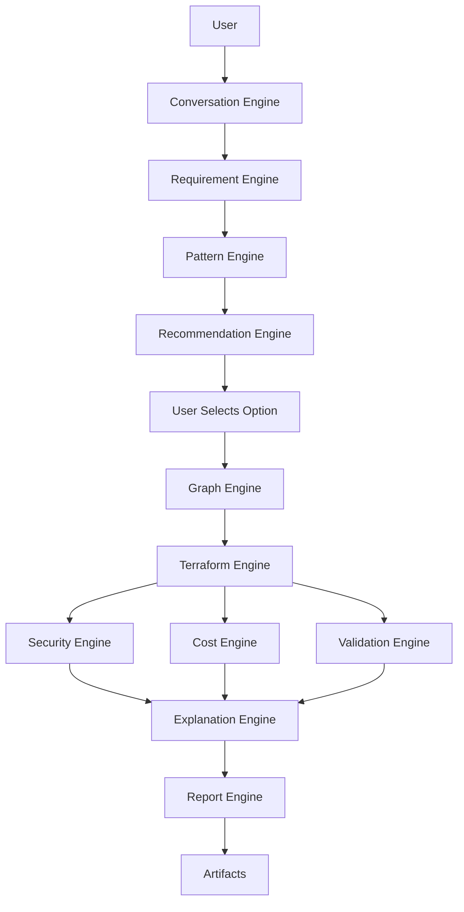

# DOPA Low-Level Design (LLD)

## 1. Repository Structure
For Sprint 1, DOPA will use a modular monorepo approach.

```text
dopa/
├── apps/
│   ├── frontend/
│   └── backend/
├── services/
│   ├── conversation-engine/
│   ├── requirement-engine/
│   ├── pattern-engine/
│   ├── recommendation-engine/
│   ├── graph-engine/
│   ├── security-engine/
│   ├── cost-engine/
│   ├── validation-engine/
│   ├── terraform-engine/
│   ├── report-engine/
│   └── explanation-engine/
├── knowledge/
├── templates/
├── schemas/
├── generated/
├── evaluation/
│   ├── requirements/
│   ├── patterns/
│   ├── graphs/
│   └── security/
└── docs/
```

## 2. Backend Architecture


## 3. Conversation Engine
* **Purpose:** Requirement discovery.
* **Input:** `{"message": "Deploy ecommerce application"}`
* **Output:** `{"next_question": "Expected daily traffic?"}`
* **Data Model:** `{"project_id": "123", "conversation": []}`

**Internal Flow:**


## 4. Requirement Engine
* **Purpose:** Convert chat into structured data.
* **APIs:** 
  * `POST /requirements/extract`
  * `GET /requirements/{projectId}`

**Schema:**
```json
{
 "project_id": "123",
 "cloud": "aws",
 "region": "ap-south-1",
 "application_type": "ecommerce",
 "users_per_day": 10000,
 "availability": "high",
 "database": "postgresql",
 "budget": "medium"
}
```

## 5. Knowledge Base
* **Folder:** `knowledge/`
* **Contents:**
  * `architecture-patterns.json`
  * `tradeoff-rules.json`
  * `service-capabilities.json`
  * `security-rules.json`
  * `validation-rules.json`
  * `cost-rules.json`
  * `question-flows.json`
  * `terraform-module-catalog.json`
  * `recommendation-rules.json`

**Example `architecture-patterns.json`:**
```json
{
 "pattern": "ecommerce",
 "conditions": {
   "traffic": "medium"
 },
 "services": [
   "cloudfront",
   "alb",
   "ecs",
   "rds"
 ]
}
```

## 6. Pattern Engine
* **Purpose:** Requirement → Architecture Pattern
* **Input:** `{"application_type": "social_media", "users": 5000000}`
* **Output:** `{"pattern": "global_realtime_platform"}`
* **APIs:** `POST /patterns/match`

**Process:**


## 7. Recommendation Engine
* **Purpose:** Generate A/B/C architectures.
* **Output Example:**
```json
{
 "options": [
   {"name": "A", "type": "cheapest"},
   {"name": "B", "type": "balanced"},
   {"name": "C", "type": "enterprise"}
 ]
}
```

**Internal Flow:**


## 8. Architecture Graph Engine
*The most important module. It serves as the Source of Truth.*

**Internal Flow:**


* **APIs:** 
  * `POST /graph/generate`
  * `GET /graph/{projectId}`

**Schemas:**
```json
// Graph
{ "nodes": [], "edges": [] }

// Node
{
 "id": "ecs_1",
 "type": "compute",
 "service": "ecs",
 "metadata": {}
}

// Edge
{
 "source": "alb",
 "target": "ecs",
 "relation": "routes_to"
}
```

## 9. Security Engine
* **Purpose:** Graph Security Analysis
* **Output:** `{"risk": "medium", "findings": []}`

**Flow:**


## 10. Cost Engine
* **Purpose:** Cost Estimation (V1 relies exclusively on `cost-rules.json` to bypass live AWS API latency).
* **Output Example:** `{"monthly_cost": 350, "currency": "USD"}`
* **Breakdown Example:** `{"ecs": 100, "rds": 150, "s3": 20, "alb": 80}`

**Flow:**


## 11. Validation Engine
* **Purpose:** Final Quality Gate
* **Validation Types:** Terraform Validation, Architecture Validation, Security Validation.
* **Tools:** `terraform fmt`, `terraform validate`, Checkov, Trivy.
* **Output:** `{"status": "pass"}`

## 12. Terraform Engine
* **Purpose:** Generate IaC (Infrastructure as Code)
* **Folder Generated:**
```text
terraform/
├── provider.tf
├── variables.tf
├── outputs.tf
└── modules/
```

**Internal Flow:**


## 13. Explanation Engine
* **Purpose:** Provide user trust by answering *Why* an architecture was chosen.
* **Input:** Selected Option (e.g., Option A).
* **Output Example:**
  ```json
  {
   "chosen_because": [
     "Team size small",
     "Lower operational overhead",
     "Cost target under $300/month",
     "Kubernetes not required"
   ]
  }
  ```

## 14. Report Engine
* **Purpose:** Generate Documents
* **Inputs:** Graph, Security Report, Cost Report, Terraform Report, Explanation Narrative.
* **Outputs:** `HLD.md`, `LLD.md`, `Security.pdf`, `Cost.pdf`

## 15. Database Design (PostgreSQL)
| Table | Key Columns |
|---|---|
| **users** | id, email, name, plan, created_at |
| **projects** | id, user_id, name, description, cloud_provider, status, current_graph_version, created_at |
| **conversations** | id, project_id, role, message, created_at |
| **requirements** | id, project_id, version, requirements_json, created_at |
| **architecture_graphs** | id, project_id, version, graph_json, pattern_id, created_at |
| **security_reports** | id, project_id, graph_version, risk_score, report_json |
| **cost_reports** | id, project_id, graph_version, estimated_monthly_cost, report_json |
| **validation_reports** | id, project_id, graph_version, status, report_json |
| **terraform_packages** | id, project_id, graph_version, package_path, created_at |
| **reports** | id, project_id, report_type, graph_version, file_path |

## 16. API Layer
**Endpoints:**
* `POST /api/v1/projects`
* `GET  /api/v1/projects/{id}`
* `POST /api/v1/conversation/message`
* `POST /api/v1/requirements/extract`
* `POST /api/v1/patterns/generate`
* `POST /api/v1/recommendations/generate`
* `POST /api/v1/graph/generate`
* `POST /api/v1/terraform/generate`
* `POST /api/v1/security/analyze`
* `POST /api/v1/cost/analyze`
* `POST /api/v1/validation/check`
* `POST /api/v1/explanation/generate`
* `POST /api/v1/reports/generate`

---

## 🚀 Sprint 1 Service Flow


## 17. Core Engines Pipeline Reference

For the pure-Python engine implementation plan, see [Docs/core_engines_pipeline_v1.md](D:/Mine/DOPA/Docs/core_engines_pipeline_v1.md).

