# DOPA Sprint 1 End-to-End Flow

Before starting implementation, review [Docs/pre_sprint1_launch_checklist.md](D:/Mine/DOPA/Docs/pre_sprint1_launch_checklist.md).

## 🌟 Sprint 1 Execution Pipeline

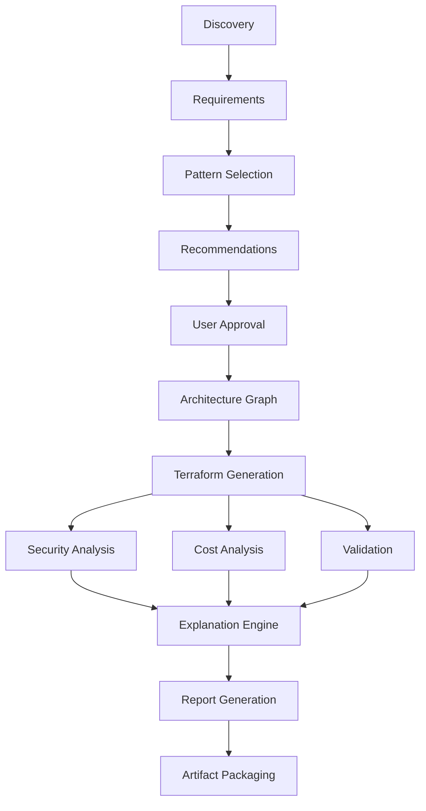

---

## 🛠️ Detailed Sequence Diagrams

### Phase 1: Project Creation
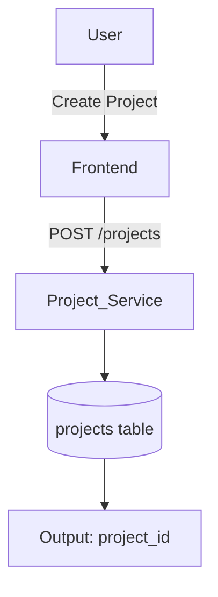

### Phase 2: Requirement Discovery
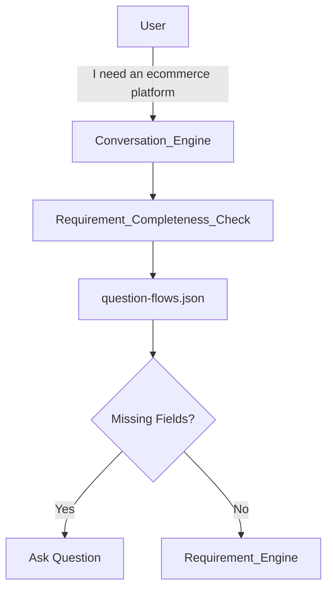
*Example requirements gathered: Cloud Provider, Traffic, Region, Database, Availability, Budget.*

### Phase 3: Requirement Normalization
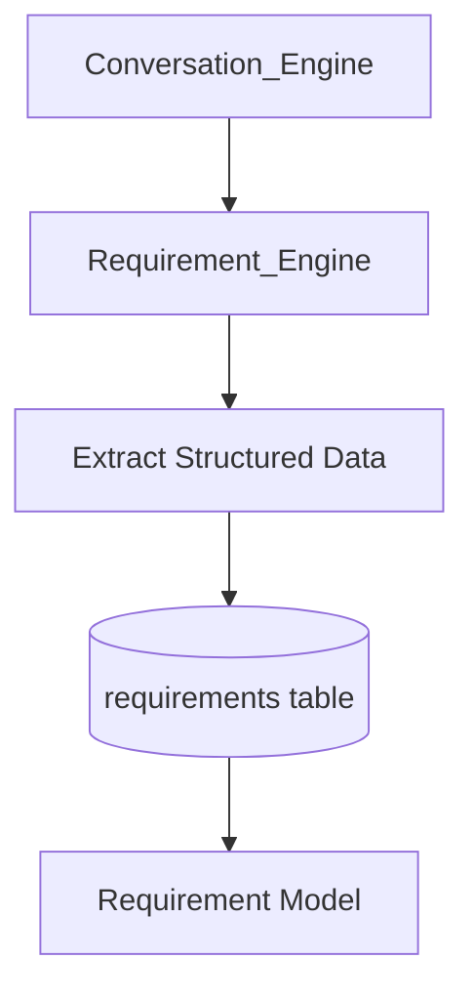

### Phase 4: Pattern Selection
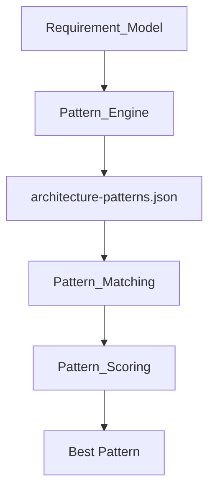
**Cloud-Agnostic Knowledge Base:** The `architecture-patterns.json` schema is designed to be cloud-agnostic, easily supporting AWS, Azure, or GCP configurations later.

### Phase 5: Recommendation Generation
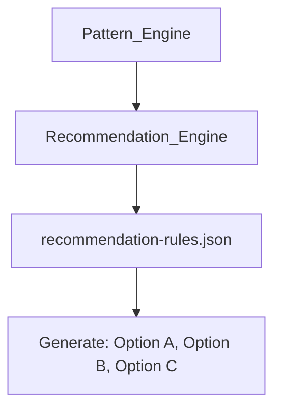

### Phase 6: User Approval
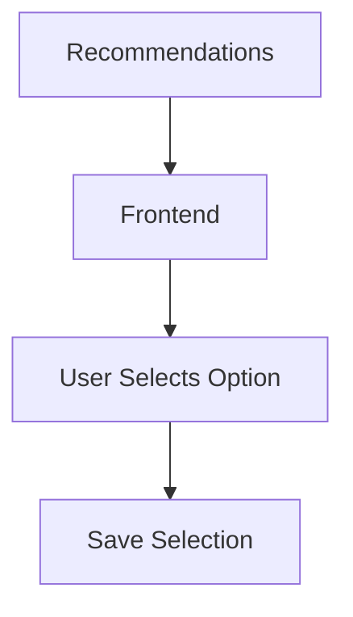

### Phase 7: Architecture Graph Generation
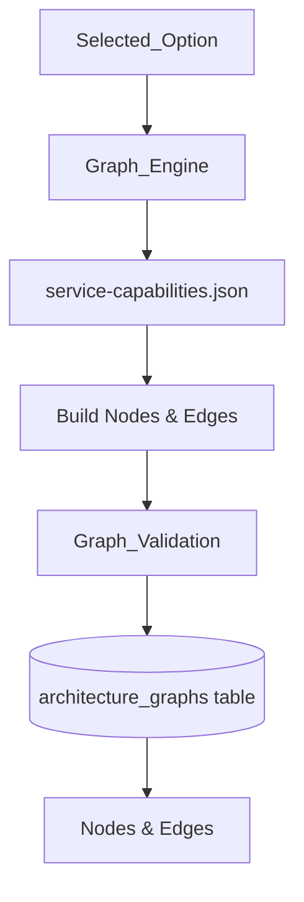
**Interactive Architecture Canvas:** The generated Architecture Graph functions as an interactive sandbox in the UI. Users can click nodes to change configurations, triggering real-time re-runs of Security validations and Architecture Checks (Cost validations run once at final generation).

### Phase 8: Terraform Generation
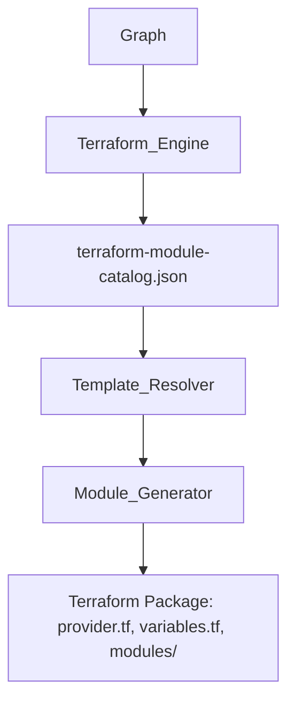

### Phase 9: Parallel Analysis
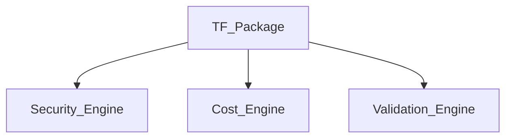

**Security Flow**
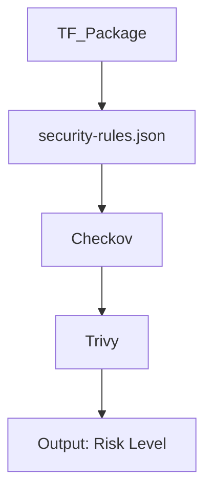

**Cost Flow**
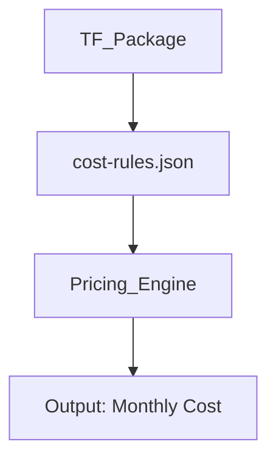

**Validation Flow**
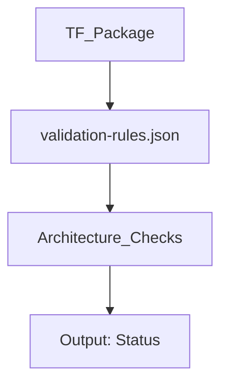

### Phase 10: Terraform Validation
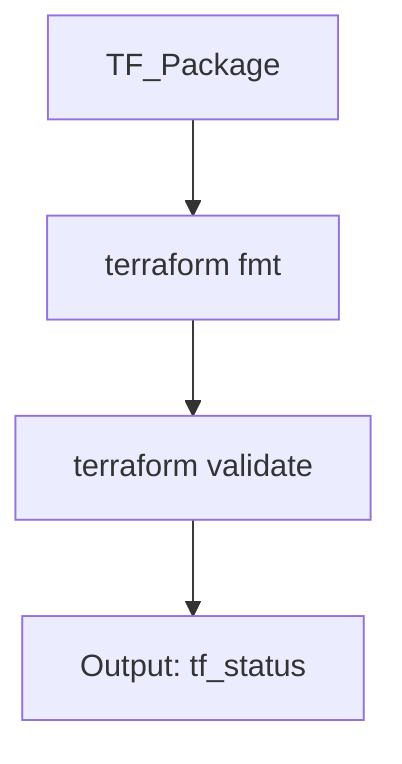

### Phase 11: Explanation Engine
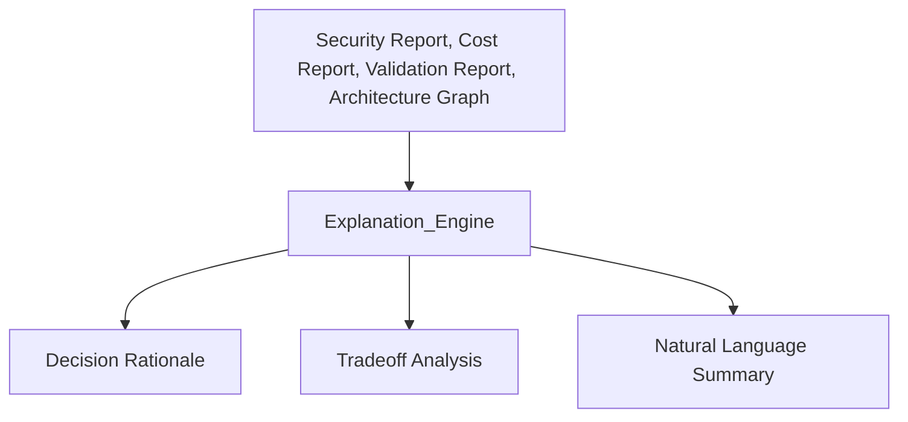
*The Explanation Engine generates natural language rationale for why each architectural decision was made, including tradeoff analysis and justification for component selections.*

### Phase 12: Report Generation
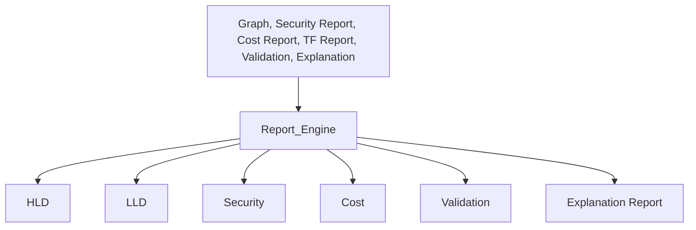

### Phase 13: Artifact Packaging
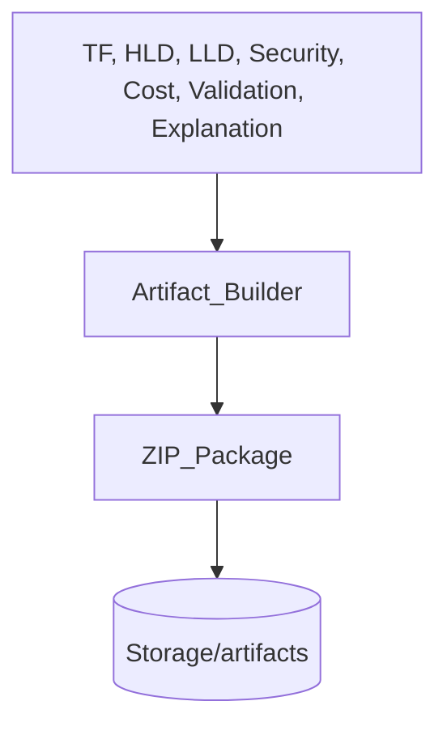

---

##  Final User Flow

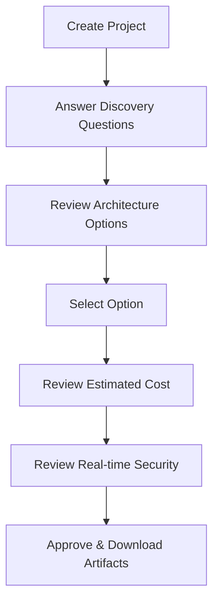
