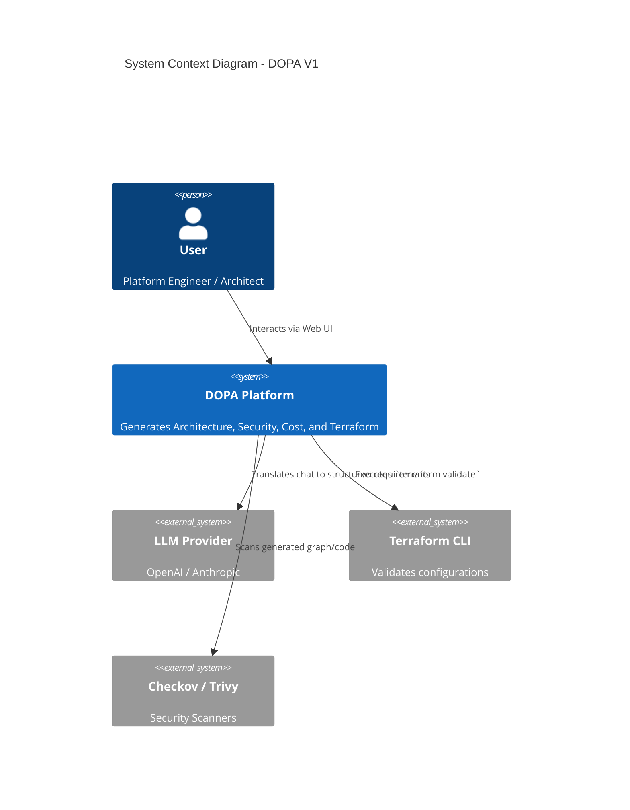
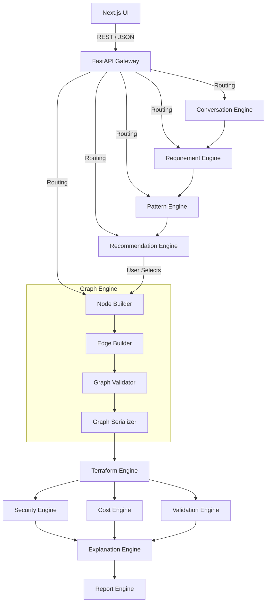

# DOPA Detailed System Design v1.0

## 1. System Overview & Context Diagram

DOPA (DevOps Planning & Architecture) is an expert system combining an LLM conversational interface with deterministic graph-based evaluation engines.

## 2. Component Architecture

### 2.1 Frontend (Next.js 15)
* **Framework:** Next.js (App Router), React 18, TypeScript.
* **State Management:** React Context (User/Project State), TanStack Query (Server State/API caching).
* **UI Library:** TailwindCSS, Shadcn UI.
* **Canvas Engine:** React Flow (for interactive graph rendering).

### 2.2 Backend (FastAPI)
* **Framework:** FastAPI (Python 3.12).
* **ORM:** SQLAlchemy with Alembic for migrations.
* **Validation:** Pydantic V2 for API and JSON schema validation.
* **AI Integration:** LangChain or direct LLM SDKs wrapped in an Internal Gateway.

### 2.3 Service Boundaries (Ownership)
* **Conversation Engine:** Chat orchestration, Question generation, Context management.
* **Requirement Engine:** Extraction, Normalization, Schema validation.
* **Pattern Engine:** Pattern matching, Scoring, Ranking.
* **Recommendation Engine:** Options formulation (Cheapest, Balanced, Enterprise), Tradeoff mapping.
* **Graph Engine:** Node building, Edge building, Cyclic dependency validation, Graph serialization.
* **Terraform Engine:** Template resolution, Module generation, Artifact building.
* **Security & Validation Engines:** Artifact scanning (Checkov/Trivy), Terraform syntax validation (`terraform validate`), Architecture rule validation.
* **Explanation & Reporting Engines:** Natural language rationale generation, Markdown/PDF document compilation.

## 3. Detailed API Specifications

*All endpoints are prefixed with `/api/v1/`*

### 3.1 `POST /projects`
* **Request:** `{"name": "Ecommerce", "cloud_provider": "aws", "description": "..."}`
* **Response:** `{"id": "uuid", "status": "created"}`

### 3.2 `POST /conversation/message`
* **Request:** `{"project_id": "uuid", "message": "I need a scalable DB"}`
* **Processing:** LLM extracts context, checks `question-flows.json`.
* **Response:** `{"reply": "What is your expected read/write ratio?", "is_complete": false}`

### 3.3 `POST /requirements/extract`
* **Request:** `{"project_id": "uuid"}`
* **Response:** `{"requirements": {"cloud": "aws", "traffic": 10000, ...}}`

### 3.4 `POST /patterns/generate`
* **Request:** `{"requirements": {...}}`
* **Response:** `{"pattern_id": "ecommerce", "options": ["A", "B", "C"]}`

### 3.5 `POST /graph/generate`
* **Request:** `{"project_id": "uuid", "selected_option": "B"}`
* **Response:** `{"graph_id": "uuid", "nodes": [...], "edges": [...]}`

## 4. Database Schema (PostgreSQL)

*Uses UUIDs for all primary keys.*

1. **`users`**: `id`, `email`, `name`, `created_at`
2. **`projects`**: `id`, `user_id`, `name`, `cloud_provider`, `status`, `current_graph_version`
3. **`conversations`**: `id`, `project_id`, `role` (user/assistant), `message`, `created_at`
4. **`requirements`**: `id`, `project_id`, `requirements_json`, `version`
5. **`architecture_graphs`**: `id`, `project_id`, `version`, `graph_json`, `pattern_id`
6. **`security_reports`**: `id`, `project_id`, `graph_version`, `risk_score`, `report_json`
7. **`cost_reports`**: `id`, `project_id`, `graph_version`, `estimated_monthly_cost`, `report_json`
8. **`validation_reports`**: `id`, `project_id`, `graph_version`, `status`, `report_json`
9. **`terraform_packages`**: `id`, `project_id`, `graph_version`, `package_path`
10. **`reports`**: `id`, `project_id`, `report_type`, `graph_version`, `file_path`

## 5. Knowledge Base Configuration

To prevent hardcoding, DOPA relies entirely on JSON configuration files loaded into memory at backend startup.
**File locations:** `/backend/knowledge/*.json`

**Loading Strategy:**
1. FastAPI `@asynccontextmanager` startup event triggers `KnowledgeLoader.load_all()`.
2. Validates JSON schemas via Pydantic on startup. Fails to boot if schemas are invalid.
3. Cached in memory (`Dict[str, Any]`) for 0ms latency reads.\n4. Curated AWS resource exposure profiles are loaded from `aws-resource-schemas.json` for Terraform and UI field selection.

## 6. End-to-End State Machine

A Project moves through distinct states in `projects.status`:
1. `DISCOVERY`: User is chatting with the Conversation Engine.
2. `REQUIREMENTS_GATHERED`: All mandatory fields in `question-flows.json` are filled.
3. `OPTIONS_GENERATED`: A/B/C architectures are available for user review.
4. `GRAPH_GENERATED`: User selected an option, graph JSON is built.
5. `TERRAFORM_GENERATING`: Generating modules and templates from the Graph.
6. `ANALYZING`: Security, Cost, and Validation engines execute on the Graph and generated artifacts.
7. `EXPLAINING`: Explanation Engine generates the natural language rationale for the chosen architecture.
8. `COMPLETED`: Zip files and reports are ready for download.
9. `FAILED`: An error occurred during deterministic execution.

## 7. Error Handling & Edge Cases

### 7.1 LLM Hallucinations
* **Issue:** LLM attempts to output an invalid architecture pattern or unexpected JSON.
* **Mitigation:** The Requirement Engine strictly parses LLM output using Pydantic. If the output does not map to schemas in `architecture-patterns.json`, a retry loop (max 3 times) is triggered with error context injected back to the LLM. If it still fails, fallback to manual user input UI.

### 7.2 Terraform Generation Failures
* **Issue:** Node properties map incorrectly to variables in `terraform-module-catalog.json`.
* **Mitigation:** The Validation Engine runs `terraform validate` in a subprocess. If it fails, the `projects.status` becomes `FAILED`, and the exact Terraform stdout error is saved in `validation_reports` for debugging.

### 7.3 Concurrency & Race Conditions
* **Issue:** User clicks "Generate" multiple times rapidly or opens multiple tabs.
* **Mitigation:** FastAPI endpoints for generation check `if project.status == 'ANALYZING'`. If true, return HTTP 409 Conflict. Database locks (e.g., `SELECT FOR UPDATE`) are used during state transitions.

### 7.4 Graph Validation Failures
* **Issue:** An edge references a node ID that doesn't exist, or cyclical dependencies are created.
* **Mitigation:** Graph Engine runs a deterministic Directed Acyclic Graph (DAG) validation pass before saving to the DB. Checks for cyclic dependencies (unless explicitly allowed for specific relations) and orphaned nodes.

## 8. Security, Auth, & File Storage

* **Authentication:** Next-Auth (Frontend) passing JWT Bearer tokens to FastAPI.
* **Storage:** `terraform_packages` and `reports` are generated in a temporary `/tmp/project_{id}/` directory. Once compiled and zipped, they are moved to a persistent volume (Local disk for V1, abstracting via Python's `pathlib` for easy S3 migration in V2).
* **Data Isolation:** Every API endpoint strictly verifies that the `project_id` belongs to the authenticated `user_id` making the request.

## 9. Evaluation Layer
To ensure DOPA improves reliably without regressing, a `backend/tests/evaluation/` directory is maintained.
* **Location:** `/backend/tests/evaluation/`
* **Contents:**
  * `requirements/`: Tests mapping unstructured text to structured JSON requirements.
  * `patterns/`: Tests verifying the correct pattern is chosen for given requirements.
  * `graphs/`: Snapshots of generated JSON graphs to detect diffs/regressions.
  * `security/`: Tests mapping specific architectures (e.g., public database) to expected critical risks.
* **Execution:** Run automatically during CI (`pytest backend/tests/evaluation/`).

## 10. Development & Deployment Strategy (V1)

* **Local Environment:** Docker Compose.
  * `frontend` container (Next.js dev server, port 3000)
  * `backend` container (Uvicorn with hot-reload, port 8000)
  * `db` container (PostgreSQL 16, port 5432)
* **CI/CD:** GitHub Actions.
  * *Job 1:* Prettier & ESLint for Frontend.
  * *Job 2:* PyTest, Black, and Flake8 for Backend.
  * *Job 3:* Pydantic validation of all `.json` files in the `knowledge/` directory to ensure no PR breaks the knowledge base schemas.
  * *Job 4:* Execute `pytest backend/tests/evaluation/` to catch regressions in the deterministic engines.

## 11. Architecture Decision Records (ADR)

DOPA architectural changes must be recorded in `/Docs/adr/` when they affect system shape, runtime behavior, data ownership, or external dependencies.

**Rules:**
* Use the file format `ADR-{number}-{title}.md`.
* Record the problem, decision drivers, considered options, decision, consequences, and follow-up actions.
* Reference the relevant ADR from design docs when a decision changes the system model.
* Treat ADRs as living architecture history, especially for decisions that affect caching, determinism, or service boundaries.
